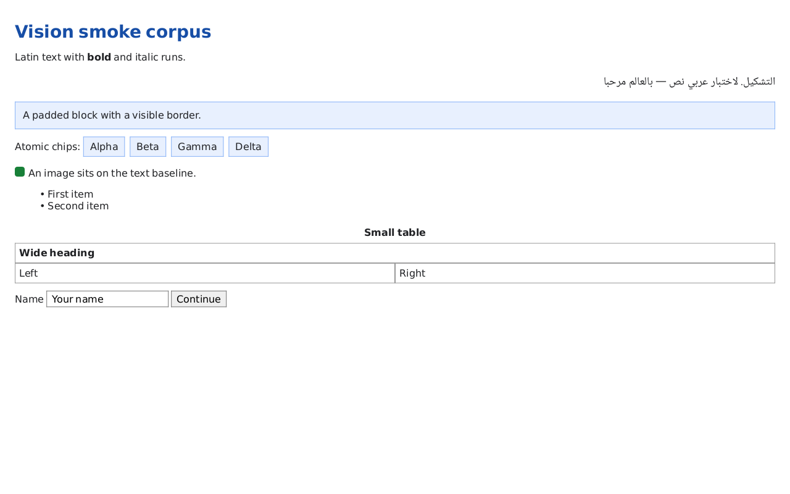
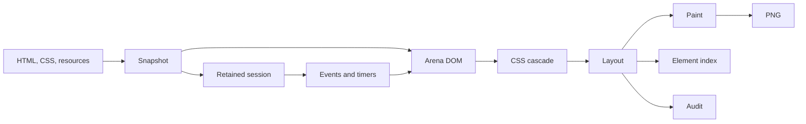

<div align="center">
  
  <h1>Vision MCP</h1>
  <p><strong>Browserless UI rendering and layout auditing for coding agents.</strong></p>
  <p>Render HTML and CSS to PNG, inspect element geometry, audit accessibility, and interact with a page on a low-resource machine — without Chromium, WebView, Playwright, or a browser engine.</p>

  [](https://github.com/JamalMellouki/vision-mcp/actions/workflows/ci.yml)
  [](https://github.com/JamalMellouki/vision-mcp/releases)
  [](https://www.rust-lang.org/)
  [](#license)
  [](#status)
</div>

## Why Vision

Coding agents can write a page faster than they can look at it. Most agents
either need a full browser, a remote screenshot service, or a visual check that
is unavailable on the machine where the code actually runs.

Vision closes that loop with a small, deterministic renderer written in Rust.
It is built for:

- coding agents such as Claude Code, Codex, OpenCode, Kilo Code, Kimi Code, and
  any MCP-capable client;
- Termux, ARM boards, containers, and low-memory Linux machines;
- local UI fixtures, component libraries, SSR output, and regression pages;
- automation that needs a PNG, element rectangles, accessibility findings, or a
  scripted click without installing a browser.

## Who it is for

- Coding-agent and MCP client builders who need a local visual tool.
- Frontend and design-system engineers on constrained machines.
- Termux, ARM, and low-RAM users who cannot run a browser stack.
- CI engineers who want deterministic screenshots without Chromium in every job.
- Maintainers who need a cheap first pass on layout and accessibility.

The core never embeds Chromium, WebKit, Blink, Playwright, a WebView, or
Lightpanda. The optional `vision-browser` adapter can capture a page through an
installed Chromium and freeze it as a `Snapshot`, but it is not a dependency of
the renderer.

## Philosophy

- **Small is a feature.** A renderer that fits on a weak device is more useful
  than a browser that does not fit at all.
- **Honesty beats a convincing screenshot.** Missing scripts/resources and
  unsupported features block the audit instead of producing a misleading score.
- **The agent is a first-class user.** Screenshots, element geometry, and
  session actions are the interface, not an afterthought.
- **Local by default.** The core performs no network or filesystem I/O after a
  snapshot is built.
- **Adapters stay outside.** Chromium capture is optional and never a core
  dependency.

## Goals

Vision aims to be the smallest useful visual verification loop for coding
agents:

1. Render local HTML/CSS without Chromium, WebView, or Playwright.
2. Return geometry and audit findings that an agent can act on.
3. Preserve state across click, focus, typing, scrolling, and timers.
4. Run on low-memory Linux, ARM, and Termux-class devices.
5. State every compatibility gap explicitly.

## At a glance

| Area | What you get |
| --- | --- |
| Rendering | HTML and CSS subset, block/inline/table/flex/grid layout, Arabic shaping, images, SVG, PNG output |
| Inspection | Element index with tag, id, classes, text, and pixel rectangles |
| Auditing | Contrast, target size, labels, overflow, clipping, overlap, empty elements |
| Interaction | Retained sessions with click, focus, typing, scrolling, timers, and DOM events |
| Agents | `vision-mcp` JSON-RPC server with screenshot, inspect, audit, and session tools |
| Footprint | No browser process; alpha binaries are roughly 6 MB |
| Honesty | Missing scripts/resources and unsupported features block the audit instead of producing a misleading score |



## Install

### Prebuilt alpha

Download the archive for your platform from the
[latest release](https://github.com/JamalMellouki/vision-mcp/releases). The release
workflow builds Linux x86_64/ARM64, macOS x86_64/ARM64, and Windows x86_64
artifacts.

### Build from source

```sh
git clone https://github.com/JamalMellouki/vision-mcp.git
cd vision-mcp
cargo build --release --bin vision --bin vision-mcp
```

Or install the command locally:

```sh
cargo install --path crates/vision-cli
```

Requirements: Rust 1.85 or newer. A browser is not required.

## Quick start

```sh
vision shot page.html -o page.png
vision shot page.html -o page.png --viewport 390x844 --dpr 2
vision inspect page.html
vision audit page.html --no-javascript
```

`vision shot` accepts local HTML. Local stylesheets, images, and script files
are resolved relative to the document and must stay inside its directory.

Use `--no-javascript` for a static render. A page that contains scripts then
reports a blocking `script: disabled by configuration` compatibility entry.

## Use with coding agents

Vision exposes its capabilities through a local JSON-RPC server:

```sh
vision mcp
```

A typical MCP client configuration:

```json
{
  "mcpServers": {
    "vision": {
      "command": "vision",
      "args": ["mcp"]
    }
  }
}
```

The standalone `vision-mcp` binary provides the same server. Any MCP-capable
client that can launch a stdio process can use it.

Available tools:

- `vision_shot` — render a file or HTML string to PNG.
- `vision_inspect` — return element rectangles, compatibility notes, and timings.
- `vision_audit` — return layout/accessibility findings with a screenshot.
- `vision_open` — open a retained interactive session.
- `vision_click`, `vision_focus`, `vision_type`, `vision_scroll` — drive the session.
- `vision_capture` — capture the current session state.
- `vision_close` — release the session.

A useful agent loop is:

```text
render -> inspect -> click/type -> capture -> compare -> report
```

The server runs on stdout/stdin and writes diagnostics to stderr, so it can be
launched by an editor, terminal agent, CI job, or local automation tool. See
[docs/agent-integration.md](docs/agent-integration.md) for tool contracts,
session limits, and recommended observation and interaction patterns.

## How it works



- **Snapshot**: one self-contained input containing HTML, preloaded stylesheets,
  resources, viewport, and initial state.
- **Engine**: parses, styles, lays out, paints, and audits without network or
  filesystem access.
- **Session**: keeps the parsed document and QuickJS context so an agent can
  click, type, scroll, and observe the result.
- **Adapters**: `vision-browser` captures an optional Chromium snapshot;
  `vision-build` and `vision-wasm` are planned.

Trusted local scripts run in an embedded QuickJS runtime with an in-tree DOM
facade. It is **not a security sandbox**. Use the optional browser adapter in an
isolated container for untrusted public pages.

## Workspace

| Package | Status | Responsibility |
| --- | --- | --- |
| [`vision-engine`](crates/vision-engine) | implemented | DOM, CSS, layout, text, paint, audit, images, snapshots, sessions |
| [`vision-cli`](crates/vision-cli) | implemented | `vision` command: shot, inspect, audit, capture, MCP |
| [`vision-mcp`](crates/vision-mcp) | implemented | JSON-RPC integration server for agents and automation |
| [`vision-browser`](crates/vision-browser) | implemented (optional) | Chromium DevTools capture adapter |
| `vision-build` | planned | Build/SSR entry adapter |
| `vision-wasm` | planned | Browser and edge renderer |

Only packages with working code are workspace members. The project deliberately
does not publish placeholder crates.

## Documentation

- [Getting started](docs/getting-started.md)
- [Compatibility and limitations](docs/compatibility.md)
- [Agent integration](docs/agent-integration.md)
- [Architecture](docs/architecture.md)
- [Roadmap](docs/roadmap.md)
- [Project card](docs/project-card.md)
- [Presentation outline](docs/presentation.md)
- [Architecture decisions](docs/adr)

## Roadmap

The alpha ships the renderer, the MCP interface, retained sessions, and
cross-platform release automation. Next:

- event semantics: capture/bubble, `dispatchEvent`, keyboard and pointer;
- DOM APIs: `getComputedStyle`, fragments, cloning, `matchMedia`;
- framework fixtures for React, Preact, Vue, Svelte, and Solid;
- CSS positioning, stacking, gradients, shadows, pseudo-elements, and clipping;
- `vision-build`, `vision-wasm`, PNG goldens, and ARM benchmarks.

See the [roadmap](docs/roadmap.md) and [project card](docs/project-card.md) for
the full picture.

## Status

`0.0.1-alpha`. The public API is unstable until `1.0`. The renderer already
covers React 19 production/development client rendering and hydration in manual
probes, local interaction, tables, forms, flexbox, grid, Arabic shaping, and
SVG images. The compatibility matrix is intentionally narrower than a browser;
unsupported features must be visible, never silently approximated.

## Verification

The repository is verified with:

```sh
cargo fmt --all -- --check
cargo clippy --workspace --all-targets -- -D warnings
cargo test --workspace
RUSTDOCFLAGS="-D warnings" cargo doc --workspace --no-deps
cargo check --manifest-path fuzz/Cargo.toml
```

The test suite covers the engine, CLI, MCP server, optional browser adapter,
golden corpus compatibility, deep DOM operations, timers, and session
interaction. The HTML fuzz target lives outside the workspace in `fuzz/`.

## Contributing

Read [CONTRIBUTING.md](CONTRIBUTING.md) before opening a pull request. The
project follows a conventional commit style, requires tests for behavior
changes, and asks for a clear compatibility note when a feature is intentionally
unsupported.

## Security

Read [SECURITY.md](SECURITY.md). The native engine is for trusted local content.
The optional browser adapter has a separate trust model and should run in an
isolated container when the input is public.

## License

Apache-2.0. See [LICENSE](LICENSE) and [NOTICE](NOTICE).
