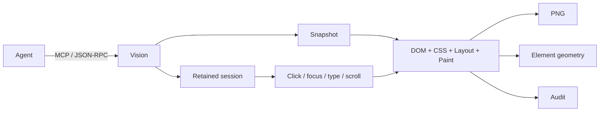
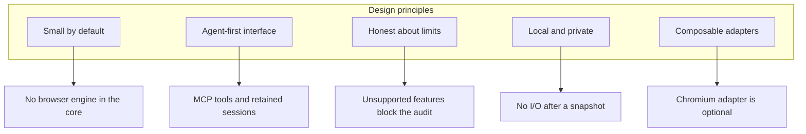
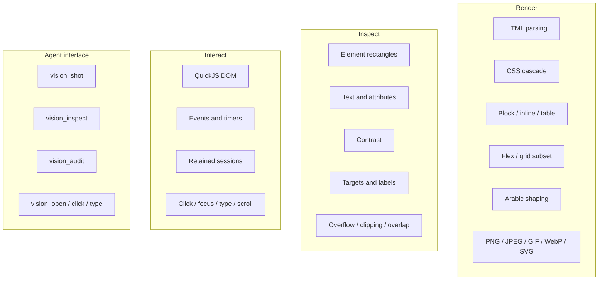
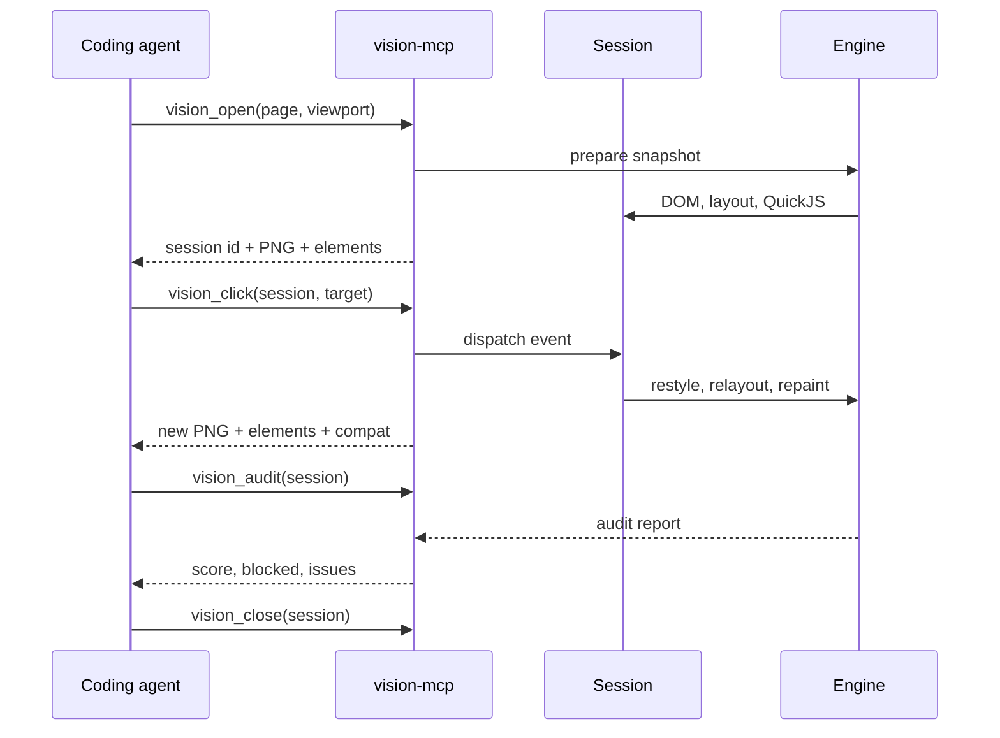
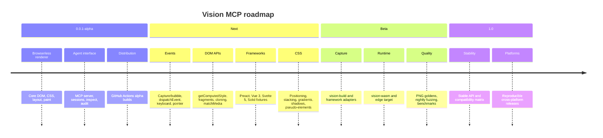
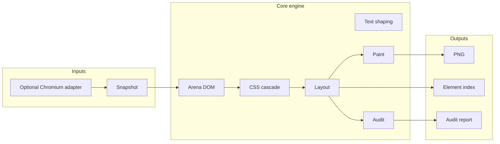

# Vision MCP — project card

> **Give coding agents eyes on the web without a browser.**

Vision MCP is a small Rust rendering and layout-auditing engine for coding
agents. It turns HTML/CSS into a PNG, an element index, an honest audit, and an
interactive session — on machines that cannot run Chromium, a WebView, a
browser, or Playwright.

| | |
| --- | --- |
| **Repository** | <https://github.com/JamalMellouki/vision-mcp> |
| **MCP server** | `vision mcp` / `vision-mcp` |
| **Status** | `0.0.1-alpha` |
| **License** | Apache-2.0 |
| **Core** | Rust, no browser engine |
| **Footprint** | Alpha binaries around 6 MB |
| **Platforms** | Linux x86_64/ARM64, macOS x86_64/ARM64, Windows x86_64 |
| **Primary users** | Coding agents, low-resource developers, CI/UI maintainers |

## The problem

A coding agent can edit a component but cannot see whether it fits, overlaps,
overflows, has an accessible control, or reacts to a click. A full browser is
often too heavy for the machine running the agent — a phone, a small ARM board,
a constrained container, or a Termux session.

## The idea

Vision provides the missing feedback loop without shipping a browser:

1. render a local page;
2. inspect exact element rectangles and text;
3. audit accessibility and layout;
4. click, focus, type, scroll, and re-capture;
5. report only what the engine can honestly verify.

## Philosophy

- **Small is a feature.** A renderer that fits on a weak device is more useful
  than a browser that does not fit at all.
- **Honesty beats a convincing screenshot.** A blocked audit is better than a
  high score on an approximate render.
- **The agent is a first-class user.** Screenshots, geometry, and session actions
  are the interface, not an afterthought.
- **Local by default.** The core performs no network or filesystem I/O after a
  snapshot is built.
- **Adapters stay outside.** Chromium capture is allowed, but never required.

## Goals

| Goal | Alpha state |
| --- | --- |
| Render HTML/CSS without Chromium or WebView | implemented subset |
| Produce a useful element index | implemented |
| Audit layout and accessibility honestly | implemented, blocked when approximate |
| Let an agent interact with a page | implemented for click/focus/type/scroll |
| Run on low-memory Linux and Termux-class devices | design target; CI builds Linux ARM64 |
| Make the MCP interface simple and scriptable | implemented |
| Support the React/framework matrix | React 19 verified; Preact/Vue/Svelte/Solid planned |
| Offer a stable 1.0 API | not yet |

## What it can do today

## The agent loop

The important rule: **check `compat.unsupported` and `audit.blocked` before
trusting a visual result.**

## Who it is for

### Target developers

- **Coding-agent and MCP client builders** who need a local visual tool.
- **Frontend and design-system engineers** working on constrained machines.
- **Termux, ARM, and low-RAM users** who cannot run a browser stack.
- **CI and release engineers** who want deterministic screenshots and geometry
  without Chromium in every job.
- **Open-source maintainers** who need a small, scriptable UI regression check.
- **Accessibility and layout reviewers** who need cheap first-pass findings.

### Not the primary target

- Teams that need pixel identity with Chromium.
- Untrusted public-page rendering in the native engine.
- Full browser API or JavaScript compatibility.
- A hosted screenshot service.

## Upcoming development

Near-term work, in priority order:

1. Event semantics: capture/bubble, `once`/`passive`, `dispatchEvent`,
   keyboard, pointer, change, and submit.
2. DOM APIs needed by real components: `getComputedStyle`, `dataset`,
   `cloneNode`, fragments, `getBoundingClientRect`, and `matchMedia`.
3. Framework fixtures: React, Preact, Vue, Svelte, and Solid.
4. CSS P0: absolute/fixed positioning, stacking, gradients, shadows,
   pseudo-elements, and overflow clipping.
5. `vision-build` and `vision-wasm` vertical slices.
6. Pixel goldens, nightly fuzzing, and a low-memory benchmark on ARM.

## Technical identity

- **No browser engine in the core.** No Chromium, WebKit, Blink, WebView,
  Playwright, or Lightpanda.
- **QuickJS** provides trusted local JavaScript with an in-tree DOM facade.
- **A `Snapshot`** is the trust boundary: after it is built, the renderer does
  not touch the network or filesystem.
- **A `Session`** keeps the document and runtime alive across agent actions.

## Project health

| Signal | Value |
| --- | --- |
| Workspace tests | 97 passing on the current development machine |
| CI | format, clippy, tests, rustdoc, fuzz-target check |
| Release automation | tag-driven GitHub Actions matrix |
| Browser test | opt-in via `VISION_BROWSER` |
| Fuzz target | `fuzz/fuzz_targets/html.rs` |
| License | Apache-2.0 |

## Non-goals

- Pixel identity with Chromium.
- A security sandbox for untrusted pages.
- A complete browser API surface.
- A remote screenshot service.
- A sample application that becomes the product.

## Links

- [README](../README.md)
- [Getting started](getting-started.md)
- [Compatibility](compatibility.md)
- [Agent integration](agent-integration.md)
- [Architecture](architecture.md)
- [Roadmap](roadmap.md)
- [Presentation outline](presentation.md)
